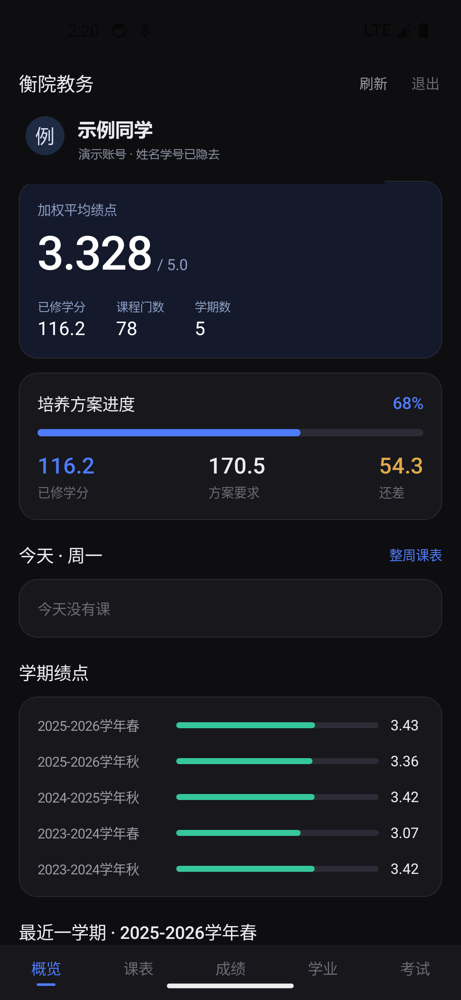
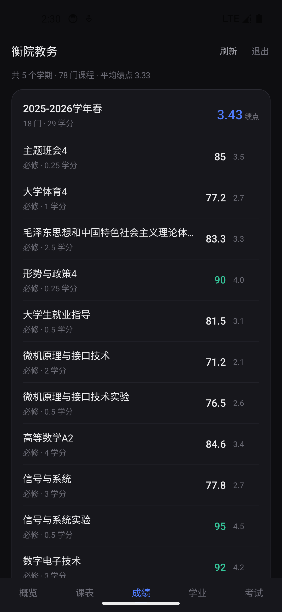
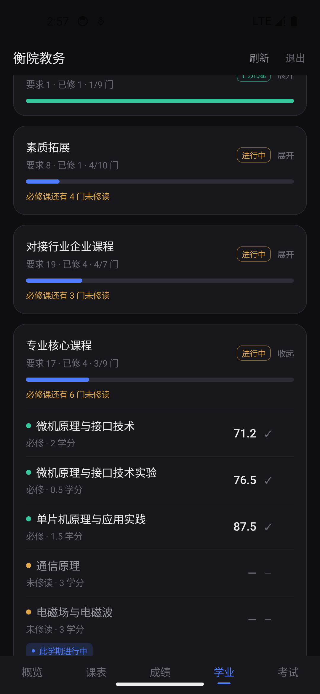
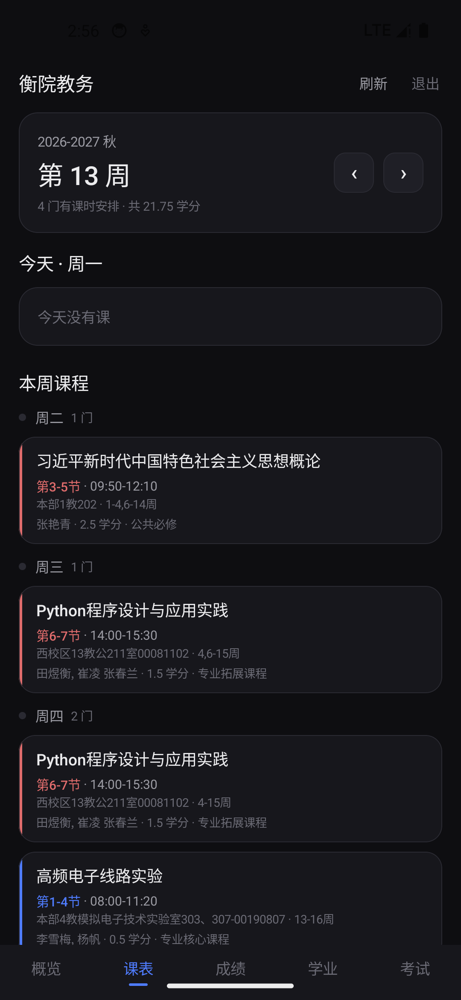
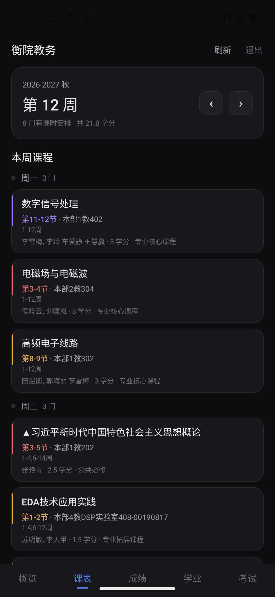
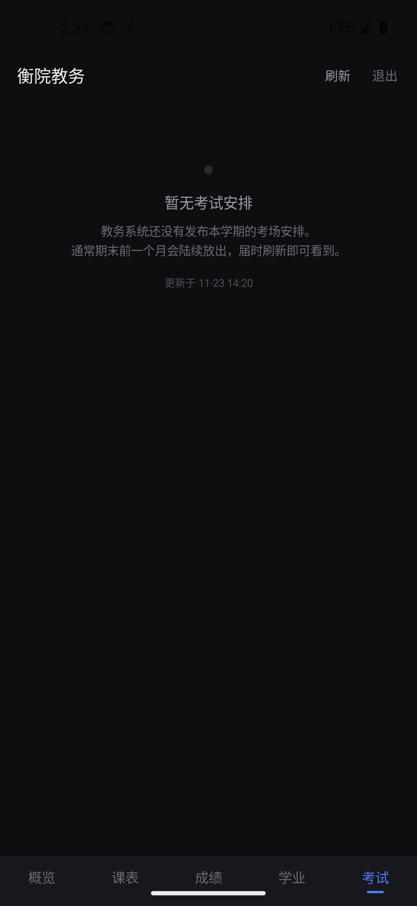

# 衡院教务 · 非官方第三方客户端

面向 **衡水学院（URP 高校教学管理与服务平台）** 的第三方 Android 客户端。用 Kotlin + Jetpack Compose 全原生实现，直接对接教务系统接口，不做 WebView 套壳。

> 个人自用向项目。不是学校官方应用，与学校无关。

## 功能

| 模块 | 说明 |
|---|---|
| 登录 | 复用教务系统表单登录（含验证码），会话 Cookie 存本机；不做任何密码持久化 |
| 概览 | 加权平均绩点、已修/应修学分、培养方案进度、学期绩点趋势、今日课程 |
| 成绩 | 按学期分组的全部课程，含学分、成绩、绩点，按分数着色 |
| 学业 | 培养方案各模块完成度，可展开看每门课；点击课程显示课程号与建议学期；未通过且本学期在修的课程标记「此学期进行中」 |
| 课表 | 按周次切换（接口本身按周返回），按星期分组，标注节次 + **上课时间**、地点、教师、周次范围 |
| 考试 | 考试安排与倒计时 |
| 成绩提醒 | 快照比对，出现新成绩时发系统通知 + 应用内横幅 |

## 截图

| 概览 | 成绩 | 学业 |
|---|---|---|
|  |  |  |

| 课表 | 课表（第 12 周） | 考试 |
|---|---|---|
|  |  |  |

> 截图中的姓名、学号已隐去，课程与成绩为演示数据。

## 技术要点

- **Kotlin + Compose**，Material 3，单 Activity
- **OkHttp** 直连，手动维护 Cookie；`usesCleartextTraffic` 因为该站点只监听 HTTP 7777
- 数据层与 UI 层分离：`UrpApi`（网络）→ `Parser`（解析）→ `Model`（模型）→ Compose 页面
- 解析层做了防御性处理：字段缺失、返回 HTML 错误页、会话过期、接口返回损坏 JSON，都会优雅降级而不是崩溃

接口与解析细节见 [docs/API.md](docs/API.md)。

## 构建

需要 JDK 17 与 Android SDK（compileSdk 35）。

```bash
git clone <this-repo>
cd hsnc-xjw-app
echo "sdk.dir=/path/to/Android/Sdk" > local.properties
./gradlew assembleDebug
```

产物在 `app/build/outputs/apk/debug/app-debug.apk`。也可以直接用 Android Studio 打开工程目录运行。

## 隐私说明

这个 App 处理的是成绩单级别的数据，所以在实现上做了取舍：

- **密码不落盘。** 登录时按站点登录页的规则做哈希后提交，任何情况下都不写入 SharedPreferences 或文件。代价是会话过期后必须重新登录，因此成绩提醒只在打开 App 或手动刷新时检查，而不是后台定时推送。
- **只存会话 Cookie。** 存在应用私有目录，退出登录即清除。
- **不采集、不上传。** 所有请求直连学校服务器，没有第三方统计或崩溃上报。
- **明文传输风险。** 该站点未提供 HTTPS，账号密码在校园网内是明文传输的。建议只在校园网或移动数据下使用，避免公共 Wi-Fi。

## 免责声明

- 本项目为个人学习用途的第三方客户端，**不是**学校官方产品，不代表学校立场。
- 使用产生的任何后果（包括但不限于账号异常、数据不一致）由使用者自行承担。
- 请勿用于批量抓取、爬取他人数据或任何商业用途。
- 学校系统升级可能导致接口失效，届时需要相应调整解析逻辑。

## License

[MIT](LICENSE)
